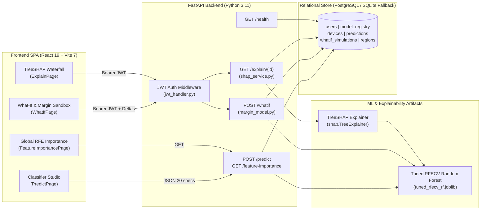

# Mobile Price-Range Classifier — Assisted Pricing Optimization Engine

An end-to-end decision-support system for mobile OEM product managers and pricing analysts. Given 20 hardware and connectivity specifications of a candidate smartphone, the platform predicts its target market price tier (`0: Low Cost`, `1: Medium Cost`, `2: Mid-High Cost`, `3: High Cost`), decomposes individual predictions using **TreeSHAP (`shap.TreeExplainer`)**, and provides an interactive **What-If Hardware & Gross-Margin Sandbox** to explore BOM cost vs. tier-positioning trade-offs in real time.

---

## Key Capabilities

1. **Classifier Studio (`POST /predict`):**
   - Validates all 20 hardware specifications via strict Pydantic v2 bounds and physical cross-field invariants (`sc_w <= sc_h`).
   - Classifies devices using our **Tuned RFECV Random Forest (`v1.1.0-tuned-rfecv`)**, achieving **94.00% hold-out test accuracy** (**0.9399 macro F1**, **0.9936 multiclass ROC-AUC**) using only the 5 highest-signal hardware features (`ram`, `battery_power`, `px_height`, `px_width`, `mobile_wt`).
2. **Global Feature Attribution (`GET /feature-importance`):**
   - Visualizes all 20 dataset features ranked by normalized Gini importance, contrasting the 5 `RFECV`-retained hardware drivers (`100%` of active split weight) against the 15 pruned low-signal radio/camera attributes.
3. **Local TreeSHAP Waterfall Explorer (`GET /explain/{prediction_id}`):**
   - Computes exact local Shapley attributions for any historical or live prediction, verifying the game-theoretic additivity identity ($\text{base\_value} + \sum \phi_i = P(\text{class}=c \mid x) \pm 10^{-4}$) on every response and caching results in the database.
4. **What-If Hardware & Illustrative Margin Sandbox (`POST /whatif`):**
   - Live 300 ms debounced sliders for the 5 active RFE hardware drivers.
   - Simulates real-time tier transitions, class probability shifts, and **illustrative BOM cost & gross-margin deltas** (`PRD Chapter 5.3` linear cost model), while automatically flagging out-of-distribution hardware overrides (`extrapolated_features`).
5. **Scoped JWT Role-Based Access (`POST /auth/login`):**
   - Protects computation-intensive simulation (`POST /whatif`) and explainability (`GET /explain/{id}`) endpoints with HS256 JWT bearer tokens and `bcrypt` password hashing.

---

## System Architecture



---

## Dataset, Cleaning & Model Performance Summary

- **Source Dataset:** Kaggle Mobile Price Classification (`data/raw/train.csv` — 2,000 labeled rows across 4 balanced price tiers; `data/raw/test.csv` — 1,000 unlabeled rows).
- **Deterministic Cleaning (`scripts/clean_data.py`):**
  - Removes physically impossible zero-dimension display or pixel records (`px_height == 0` or `sc_w == 0`) and `sc_w > sc_h` violations.
  - Produces a stratified 80/20 split (`seed = 42`): **1,600 training rows** (`data/processed/train_split.csv`) and **400 untouched hold-out test rows** (`data/processed/test_split.csv`).

| Model Version | Feature Set | 5-Fold Stratified CV Accuracy | Hold-Out Test Accuracy (`n=400`) | Hold-Out Macro F1 | Multiclass ROC-AUC (OvR) | Total Test Errors (`n=400`) |
| :--- | :--- | :---: | :---: | :---: | :---: | :---: |
| `v1.0.0-baseline` | All 20 features | 90.25% (±1.21%) | 87.50% | 0.8744 | 0.9794 | 50 / 400 |
| **`v1.1.0-tuned-rfecv` (Active)** | **5 RFE features (`ram`, `battery_power`, `px_height`, `px_width`, `mobile_wt`)** | **92.56% (±0.72%)** | **94.00%** | **0.9399** | **0.9936** | **24 / 400 (0 multi-tier)** |

---

## Local Setup & Quickstart (Verified on Clean Clone)

### Prerequisites
- **Python 3.11+** (tested on Python 3.11 / 3.12)
- **Node.js 20+** and `npm`
- *(Optional)* PostgreSQL 15+ with PostGIS. If PostgreSQL is not running locally, the backend **automatically falls back to a local SQLite database** (`artifacts/mobile_price.db`) and seeds the default analyst account and model registry on startup.

### 1. Clone the Repository & Create a Python Environment

```bash
git clone https://github.com/chaudhary-nikhil/Mobile_Price_Range_Classifier.git
cd Mobile_Price_Range_Classifier

# Windows (PowerShell)
python -m venv .venv
.\.venv\Scripts\Activate.ps1

# macOS / Linux
# python3 -m venv .venv && source .venv/bin/activate

pip install -r backend/requirements.txt
```

### 2. (Optional) Reproduce Data Cleaning, Model Training & Error Analysis

The repository already includes the trained artifacts (`artifacts/tuned_rfecv_rf.joblib`, `artifacts/baseline_rf.joblib`) and processed splits (`data/processed/`). To regenerate everything from scratch (`seed = 42`):

```bash
python scripts/clean_data.py
python scripts/train_baseline.py
python scripts/train_tuned.py
python scripts/run_error_analysis.py
```

### 3. Start the FastAPI Backend (`http://localhost:8000`)

```bash
cd backend
python -m uvicorn app.main:app --reload --port 8000
```

- Interactive Swagger API Docs: `http://localhost:8000/docs`
- Health Check: `http://localhost:8000/health`
- Seeded Analyst Account (auto-configured for What-If & Explain): `analyst@priceopt.ai` / `AnalystPass123!`

### 4. Start the React + Vite Frontend (`http://localhost:5173`)

In a second terminal from the repository root:

```bash
npm --prefix frontend install
npm --prefix frontend run dev
```

Open `http://localhost:5173` in your browser to use the Classifier Studio, Feature Importance chart, TreeSHAP Explorer, and What-If Margin Sandbox.

### 5. Run the Automated Test Suite & Linters

From the repository root:

```bash
# Run all 68 backend unit, contract, SHAP additivity, auth, and CI gate tests
python -m pytest backend/tests -v

# Run Python and Frontend linters
ruff check backend scripts
npm --prefix frontend run lint
```

---

## REST API Reference

| Method | Endpoint | Auth | Description |
| :---: | :--- | :---: | :--- |
| `POST` | `/auth/login` | Public | Exchange analyst email & password for a 24h HS256 JWT bearer token (`TC-AUTH-01`). |
| `POST` | `/predict` | Public | Validate 20 device specs, return predicted price tier (`0..3`), class probabilities, and persist `prediction_id` (`TC-API-01`, `TC-API-02`). |
| `GET` | `/explain/{prediction_id}` | Bearer JWT | Compute/fetch local TreeSHAP decomposition for `prediction_id` with additivity verification (`TC-API-03`, `TC-SHAP-01`). |
| `POST` | `/whatif` | Bearer JWT | Apply spec deltas, compute updated tier & probabilities, estimate BOM cost & gross-margin delta, and flag extrapolated specs (`TC-API-04`, `TC-UI-01`). |
| `GET` | `/feature-importance` | Public | Return all 20 features sorted by normalized Gini importance with `selected_by_rfe` flags (`TC-API-05`). |
| `GET` | `/health` | Public | Report service health, active `model_version` (`v1.1.0-tuned-rfecv`), and DB status (`TC-API-06`). |

---

## Documentation Index

- **[Model Card (`docs/model_card.md`)](docs/model_card.md):** Intended use, training workflow, 5-fold CV vs. hold-out test metrics, active RFE features, and ethical/illustrative margin disclosures.
- **[Error Analysis & OOD Report (`docs/error_analysis.md`)](docs/error_analysis.md):** Full 4x4 hold-out confusion matrix, error severity taxonomy (`24/24` single-tier boundary shifts), 3 TreeSHAP case studies, and 8 Out-of-Distribution (`OOD`) device evaluations.
- **[Requirements Traceability Matrix (`docs/traceability_matrix.md`)](docs/traceability_matrix.md):** Complete mapping of `BR-01..BR-07` and `FR-01..FR-07` to design components and automated `pytest` test IDs (`TC-API-01` through `TC-EVAL-02`).
- **[Architecture Decision Records (`docs/adr/`)](docs/adr/README.md):**
  - [ADR-001: RFECV + Random Forest Feature Selection](docs/adr/ADR-001-feature-selection-method.md)
  - [ADR-002: FastAPI + Pydantic v2 Backend Framework](docs/adr/ADR-002-backend-framework.md)
  - [ADR-003: PostgreSQL + PostGIS with Automatic SQLite Fallback](docs/adr/ADR-003-relational-data-store.md)
  - [ADR-004: TreeSHAP (`shap.TreeExplainer`) for Local Explainability](docs/adr/ADR-004-explainability-method.md)
  - [ADR-005: Split Deployment Topology (Render + Vercel)](docs/adr/ADR-005-deployment-topology.md)
